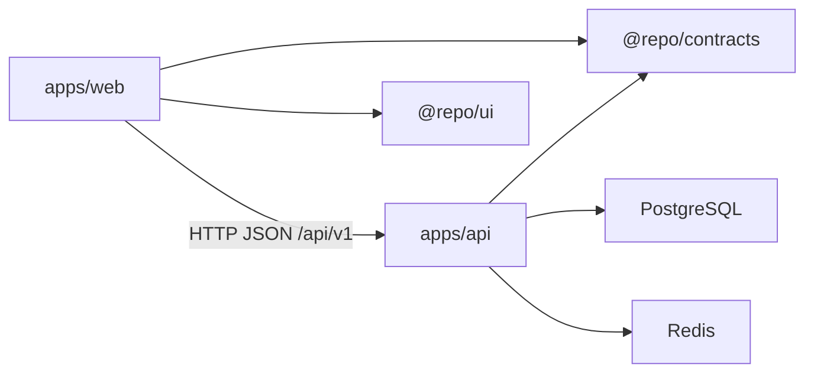

# Architecture overview

Work Board is a TypeScript monorepo. The product screen is a three-column Kanban board with create, move, a work-in-progress limit, and undo. GitHub Spec Kit 1.2.3 is initialized for specification work. See [spec-driven development](../guides/spec-driven-development.md).

## Workspaces

- `apps/web` — Next.js App Router frontend
- `apps/api` — NestJS REST API with Clean Architecture inside the app
- `packages/contracts` — shared Zod schemas and inferred types
- `packages/ui` — shadcn/ui primitives and theme
- `packages/eslint-config` — shared ESLint flat configs
- `packages/typescript-config` — shared strict TypeScript configs

## Communication

The browser talks to NestJS over REST. Shared Zod schemas validate request and response payloads on both sides. Domain models stay inside the API and are never imported by the frontend.

The Kanban board stores tasks and undo history in PostgreSQL and may answer a repeat view from Redis when the cached revision still matches `board_meta`. The API still listens when PostgreSQL or Redis is down. A board route returns an error when the saved board cannot be read. Restarting the API does not clear the board.

## Dependency rules

- `@repo/contracts` depends on Zod only.
- `@repo/ui` contains presentation primitives, not business logic.
- API domain code is pure TypeScript.
- API application use cases depend on domain contracts and the cache port, not HTTP or Prisma.
- Prisma and Redis live in infrastructure and are composed by NestJS modules.

## Key decisions

See [decisions.md](./decisions.md) and `docs/decisions/`.
